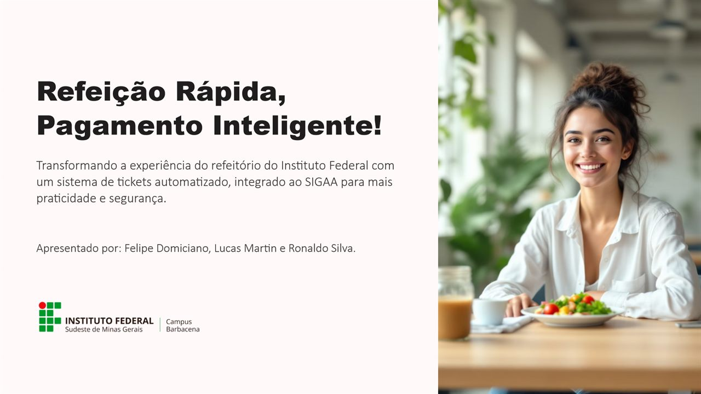
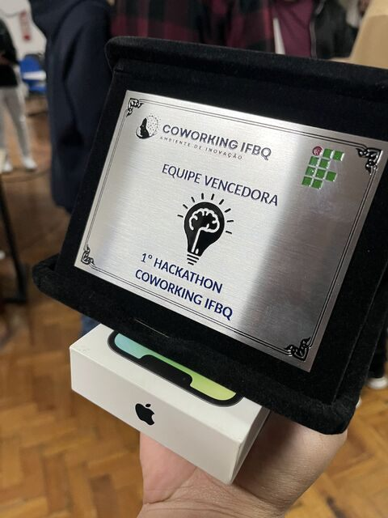
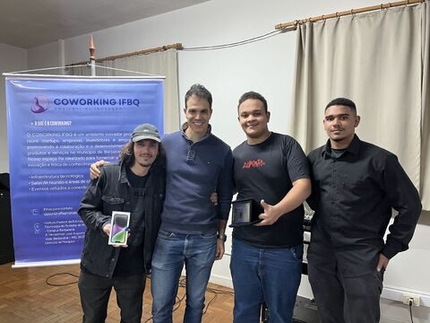
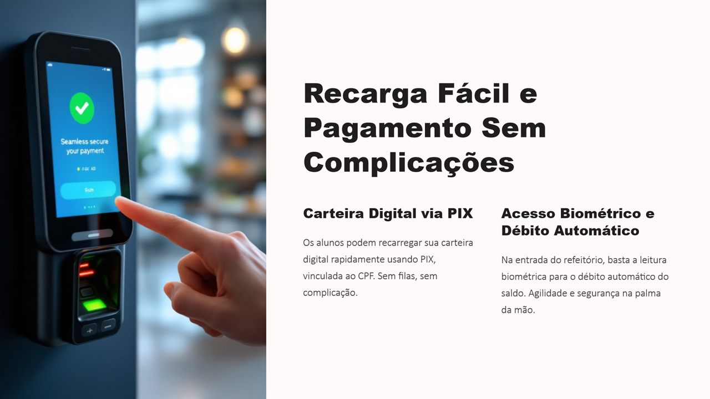
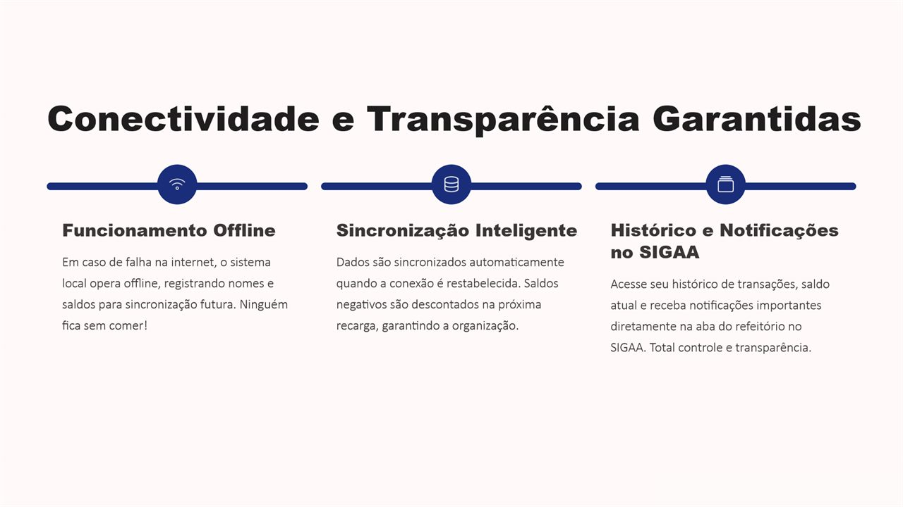

  <h1>🏆 Refeição Rápida, Pagamento Inteligente</h1>

  

    <strong>Proposta de sistema de tickets para o refeitório do Instituto Federal, com carteira digital via PIX, acesso biométrico e integração ao SIGAA.</strong>
  

  

    Solução da equipe <strong>ERROR 404</strong>, vencedora do Problema 01 no 1º Hackathon do Coworking IFBQ, no IF Sudeste MG – Campus Barbacena.
  

  

    
    
    
    
  

  

## Sobre

No 1º Hackathon do Coworking IFBQ, as equipes foram desafiadas a resolver problemas reais em tempo limitado e apresentar suas soluções a uma banca. A equipe ERROR 404 venceu o **Problema 01 – Compra de Ticket para o Refeitório**:

> Desenvolver um sistema de compra de tickets para o refeitório que permita ao usuário realizar a aquisição pelo celular, de forma autônoma, sem depender da intermediação de um servidor (pessoa).

A resposta foi uma proposta completa de sistema, apresentada em forma de pitch: do pagamento à entrada no refeitório, passando pelo que acontece quando a internet cai.

> Este é um repositório público de apresentação. Ele reúne a proposta, os slides e o reconhecimento da equipe; a solução foi apresentada como pitch, sem código-fonte.

## Reconhecimento

**1º lugar – equipe vencedora do Problema 01**  
1º Hackathon do Coworking IFBQ · IF Sudeste MG – Campus Barbacena · 15 e 18 de julho de 2025

A banca avaliadora foi formada por professores, especialistas e representantes do setor produtivo. A equipe recebeu um **iPhone 14**, placa de equipe vencedora e certificados.

  
  

📰 Notícia oficial: [Campus Barbacena realiza 1º Hackathon do Coworking IFBQ](https://www.ifsudestemg.edu.br/noticias/barbacena/campus-barbacena-realiza-1o-hackathon-do-coworking-ifbq)

## O Hackathon

O evento reuniu alunos de diferentes cursos, ex-alunos e empresários da cidade em **quatro equipes multidisciplinares** (TARS, TSI CAPIVARAS, DELTA e ERROR 404). Os desafios partiram de demandas reais:

1. **Compra de Ticket para o Refeitório** – o desafio vencido pela ERROR 404.
2. **Espaço do Egresso** – um hotsite com currículos e trajetórias de ex-alunos e vagas de empresas parceiras.
3. **Análise de Impacto Econômico dos Eventos do Município** – medir o impacto socioeconômico de eventos como a Exposição, o Natal e o Festival Gastronômico.

## A Solução

- **Carteira digital via PIX:** o aluno recarrega o saldo pelo celular, vinculado ao CPF, sem filas e sem depender de atendimento.
- **Acesso biométrico e débito automático:** na entrada do refeitório, a leitura biométrica desconta o valor da refeição do saldo.
- **Funcionamento offline:** se a internet falhar, o sistema local continua funcionando e registra nomes e saldos para sincronizar depois. Ninguém fica sem comer.
- **Sincronização inteligente:** os dados sobem sozinhos quando a conexão volta, e saldos negativos são descontados na próxima recarga.
- **Histórico e notificações no SIGAA:** saldo, transações e avisos na aba do refeitório do sistema que os alunos já usam.
- **Segurança:** dados e transações criptografados, com canal de reembolso pelo suporte ou pela diretoria.
- **Dashboard administrativo:** visão das transações diárias por aluno para a gestão financeira do refeitório.
- **Próximo passo:** uma versão em aplicativo para deixar a experiência ainda mais fluida.

## Apresentação

  

  

  📄 <a href="./apresentacao.pdf"><strong>Ver a apresentação completa (PDF)</strong></a>

## Equipe ERROR 404

- **Lucas Martin da Silva**
- **Ronaldo José da Silva Júnior**
- **Felipe José de Souza Domiciano**

## Autor

**Lucas Martin**  
[GitHub](https://github.com/cuLasss) · [LinkedIn](https://www.linkedin.com/in/lucas-m4rtin/)

---

  Ideia desenvolvida em equipe, sob pressão de tempo, com foco em resolver um problema real da comunidade do instituto.

